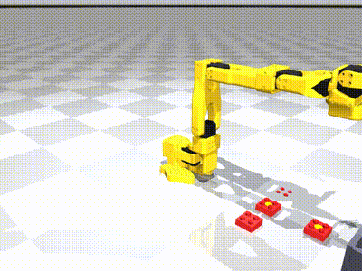
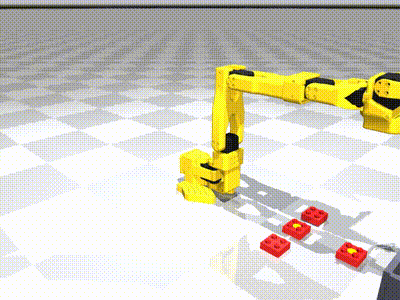

# SO-101 Robot Learning: Teleoperation → BC → PPO

Sim-to-real robot manipulation pipeline for the SO-101 arm in MuJoCo —
collecting teleoperation demonstrations, training a visual Behaviour Cloning
policy, then fine-tuning with PPO to achieve reliable cube grasping.

## Demo

| Behaviour Cloning | PPO (BC warm-start) |
|:-----------------:|:-------------------:|
|  |  |
| Smooth motion · 10 % grasp | 100 % grasp · lift emerging |

## Results

| Policy | Grasp Rate | Avg Reward | Motion Quality |
|--------|-----------|------------|----------------|
| BC only | 10 % | 0.23 | Smooth |
| PPO (BC warm-start) | **100 %** | **12.35** | Jerky (next fix) |

PPO best checkpoint saved at step 74K — policy peaked early due to BC warm-start, before curriculum phases 2 and 3 destabilised it.

## Pipeline

### 1. Teleoperation data collection
Human operator controls SO-101 in MuJoCo. Episodes saved as (image, joint_state, action) tuples to outputs/visual_dataset.npz.

### 2. Behaviour Cloning
VisualActorCritic trained with supervised learning on teleoperation data.
**Problem found:** action averaging — network predicted mean over multiple demonstration modes causing hesitation.
**Fix:** filtered conflicting episodes, lower LR for final layers.
Result: smooth motion, 10% grasp rate.

### 3. PPO fine-tuning (BC warm-start)
All 18 BC layers loaded before PPO. Curriculum reward:
- Phase 1 (0–150K steps): reach + grasp + lift
- Phase 2 (150K–300K): + inspect bonus
- Phase 3 (300K+): + bowl sorting

PPO achieves 100% grasp rate within 75K steps.
**Known limitation:** grasp reward fires once per episode (milestone) → PPO learns brief contact not sustained grip → jerky motion.

### 4. Next steps
- Continuous grasp reward (reward every step grip is maintained)
- Action smoothness penalty: −0.01 × ||aₜ − aₜ₋₁||²
- Retrain PPO with both fixes
- Sim-to-real transfer on physical SO-101

## Architecture

Image (84×84×3) → CNN encoder → concat(joint states) → Actor MLP + Critic MLP

Training: PPO-clip ε=0.2, GAE γ=0.99 λ=0.95, entropy 0.01, Adam 3e-4

## Environment

| Property | Value |
|----------|-------|
| Robot | SO-101 (6-DOF + gripper) |
| Simulator | MuJoCo 3.x |
| Observation | 84×84 RGB + joint states |
| Action | 7-dim continuous |
| Episode length | 500 steps |

## Quickstart

```bash
pip install mujoco torch imageio numpy
MUJOCO_GL=egl python3 eval_bc.py       # BC policy
MUJOCO_GL=egl python3 eval_ppo_v2.py   # PPO policy
MUJOCO_GL=egl python3 train_ppo_v2.py  # Train from scratch
```

## Author

**Mukesh Sadhasivam** — Erasmus Mundus M.Sc. Marine & Maritime Intelligent Robotics  
[github.com/sadrev25](https://github.com/sadrev25)
